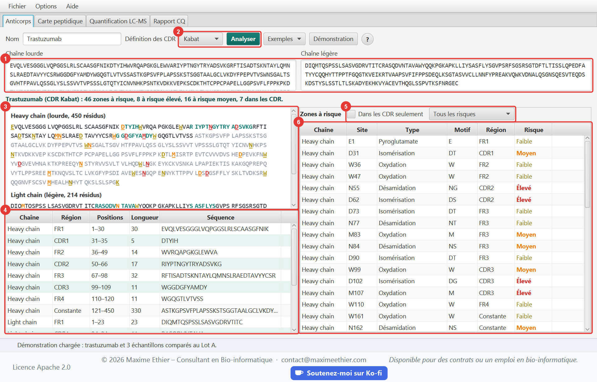

# MabScope

Outil de caractérisation des anticorps thérapeutiques en Java 21 qui permet de :

- délimiter les régions des chaînes lourde et légère (FR1 à FR4, CDR1 à CDR3, domaine constant)
  selon les définitions de Kabat, de Chothia ou AbM ;
- repérer les zones à risque de dégradation (désamidation, isomérisation, oxydation,
  N-glycosylation, cystéine non appariée, pyroglutamate, lysine C-terminale, clivage Asp-Pro) et
  leur attribuer un niveau de risque ;
- calculer la carte peptidique théorique et la masse des formes modifiées de chaque peptide, en
  notation ProForma ;
- importer les résultats LC-MS de MaxQuant, FragPipe, Skyline ou d'un tableau générique, puis
  quantifier les modifications site par site ;
- comparer des lots à un échantillon de référence, avec un seuil de comparabilité ;
- produire un rapport de contrôle qualité en PDF, en français ou en anglais.

Le même modèle est servi par deux applications indépendantes, toutes deux en architecture MVC :
une application **desktop JavaFX** et une application **web React**.



## Organisation du dépôt

```
core/       Modèle partagé (Maven, mabscope-core) : anticorps, régions, zones à risque, carte
            peptidique, import des résultats LC-MS, quantification, comparaison des lots,
            rapport PDF et façade AntibodyService
desktop/    Application desktop (Maven, mabscope-desktop) : vue JavaFX, contrôleurs, aide, i18n
server/     API REST (Maven, mabscope-server) : contrôleurs HTTP qui exposent le modèle
web/        Application web (npm) : React + TypeScript + Vite
deploy/     Installation sur un serveur Ubuntu (systemd + Caddy) et de la dépendance pride-core
config/     Règles Checkstyle communes aux modules Java
```

Les calculs de masses et de digestion proviennent de `pride-core`, le modèle de
[ProteoSpectra-Explorer](https://github.com/Aldriel/ProteoSpectra-Explorer), construit depuis son
tag de version (`deploy/install-pride-core.sh`).

### Architecture MVC et patrons de conception

| Couche | Desktop | Web |
|---|---|---|
| Modèle | `core` (`AntibodyService`) + `DesktopModel` observable | `core` via l'API REST ; `web/src/model` (`AppModel` observable, accès HTTP, types) |
| Vue | FXML : `main-view.fxml` et un fichier par onglet | `web/src/views` (composants React sans logique métier) |
| Contrôleur | `MainController` + un contrôleur par onglet | `server/.../controller` (REST) et `web/src/controllers` (hooks) |

- **Stratégie** : chaque famille de zones à risque est une règle indépendante (`LiabilityRule`) ;
  en ajouter une ne touche pas au reste de l'analyse.
- **Adaptateur** : un adaptateur par format de résultats LC-MS (MaxQuant, FragPipe, Skyline,
  tableau générique) produit les mêmes observations.
- **Monteur (Builder)** : le rapport PDF est assemblé section par section.
- **Façade** : `AntibodyService` est le seul point d'entrée des deux applications vers le modèle.

## Application desktop

- Interface **bilingue français/anglais** (menu *Options › Langue*) et **taille du texte**
  réglable (Ctrl + / Ctrl − / Ctrl 0), mémorisées.
- Exemples intégrés (trastuzumab, adalimumab) et **démonstration** (Ctrl+D) : trastuzumab et les
  résultats simulés de trois échantillons (deux lots et un échantillon stressé à 40 °C).
- Menu **Aide** : guide d'utilisateur illustré (F1) avec recherche, bouton **?** dans chaque
  onglet, raccourcis clavier, liens IMGT, abYsis et ProForma, **À propos**.

Le guide est rédigé en Markdown :
[`guide_fr.md`](desktop/src/main/resources/com/bioinfo/mabscope/desktop/help/guide_fr.md),
[`guide_en.md`](desktop/src/main/resources/com/bioinfo/mabscope/desktop/help/guide_en.md).
Ses captures d'écran et les icônes sont générées automatiquement :

```powershell
mvn -pl desktop javafx:run@screenshots   # captures FR + EN du guide
mvn -pl desktop javafx:run@icons         # icônes PNG + packaging/MabScope.ico
```

### Distribution Windows

```powershell
cd desktop
.\package-windows.ps1            # ajouter -SkipTests pour aller plus vite
```

Le script produit `desktop/target/dist/MabScope-<version>-windows-x64.zip`. Ce zip est autonome :
il contient `MabScope.exe` et un runtime Java 21 allégé par jlink, donc aucune installation de
Java n'est requise. L'utilisateur décompresse l'archive et lance l'exécutable.

## Application web

L'application web offre les mêmes fonctions que l'application desktop, onglet par onglet : mêmes
calculs, mêmes messages FR/EN, même guide illustré. Les différences tiennent au navigateur :

- **Alt+1 à Alt+4** changent d'onglet (Ctrl+1 à 4 sont réservés aux onglets du navigateur) ;
- le rapport PDF est **téléchargé** (Ctrl+S) plutôt qu'enregistré à un emplacement choisi ;
- un double-clic sur un peptide ou une forme modifiée copie sa séquence ProForma ;
- le guide s'ouvre dans un panneau à droite plutôt que dans une fenêtre ;
- la langue et la taille du texte sont mémorisées par le navigateur.

Le serveur ne garde aucune donnée entre deux requêtes : le client renvoie l'anticorps et les
résultats importés avec chaque calcul.

Le guide web est adapté du guide desktop : [`guide_fr.md`](web/src/help/guide_fr.md),
[`guide_en.md`](web/src/help/guide_en.md). Ses captures sont générées en pilotant l'application
dans Microsoft Edge :

```powershell
cd web; npm run screenshots              # API et "npm run dev" lancés
```

## Démarrage rapide

Prérequis : JDK 21, Maven 3.9, Git et Node.js 20 ou plus récent.

```powershell
bash deploy/install-pride-core.sh        # une seule fois : installe pride-core (Git Bash)
.\mvnw install -DskipTests               # compile les modules Java
.\mvnw -pl desktop javafx:run            # application desktop

.\mvnw -pl server exec:java              # API REST sur http://127.0.0.1:7071/api
cd web; npm ci; npm run dev              # application web sur http://localhost:5174
```

En développement, Vite redirige les appels `/api` vers le serveur REST.

## Qualité du code

- **Lisibilité** : aucune ligne ne dépasse 100 colonnes. Le code Java est formaté avec
  google-java-format (style AOSP, indentation de 4 espaces), le code TypeScript avec Prettier.
- **Commentaires** : chaque classe et chaque méthode publique est documentée en Javadoc ou TSDoc.
- **Vérifications automatiques** :
  - Checkstyle (`config/checkstyle`) s'exécute dès la phase `validate` de Maven et fait échouer le
    build en cas de violation ;
  - ESLint (TypeScript, règles des hooks React) et Prettier côté web ;
  - l'intégration continue GitHub (`.github/workflows/ci.yml`) compile et teste tout à chaque
    envoi, y compris les tests fonctionnels du site web.

## Tests et couverture

```powershell
.\mvnw verify                    # Checkstyle, tests JUnit 5 et couverture JaCoCo
cd web; npm run check            # types, ESLint, Prettier, tests Vitest et couverture
npm run test:e2e:local           # tests fonctionnels Playwright (API et "npm run dev" lancés)
```

| Module | Tests | Contenu |
|---|---|---|
| `core` | 156 | Régions et CDR (trastuzumab, adalimumab), zones à risque, digestion, formes modifiées, adaptateurs LC-MS, quantification, comparaison des lots, rapport PDF |
| `desktop` | 91 | Modèle, contrôleurs sur JavaFX sans écran (Monocle), messages FR/EN, guide d'aide, préférences |
| `server` | 31 | Tests d'intégration de l'API REST et des codes d'erreur |
| `web` (Vitest) | 114 | Modèle (dernier appel gagnant), accès à l'API, contrôleurs et vues, menus, tableaux, guide, messages FR/EN |
| `web` (Playwright) | 10 × 2 | Parcours d'un visiteur en français et en anglais : exemples avec chaque définition des CDR, filtres, erreur, carte peptidique, démonstration, imports CSV et MaxQuant, rapport PDF, guide, menus |

JaCoCo fait échouer le build si la couverture d'un module Java passe sous **95 % des lignes** et
**90 % des branches** ; Vitest applique les mêmes seuils au client web. Une vérification
quotidienne (`.github/workflows/monitor.yml`) rejoue les tests fonctionnels sur le site en ligne.

## API REST

| Méthode | Route | Description |
|---|---|---|
| GET | `/api/health` | État du serveur |
| GET | `/api/examples` | Anticorps d'exemple : `[{id, name, heavy, light}]` |
| GET | `/api/examples/demo-results` | Résultats LC-MS simulés de la démonstration |
| POST | `/api/analysis` | `{name, heavy, light, scheme}` : régions et zones à risque |
| POST | `/api/peptide-map` | `{antibody, digestion}` : carte peptidique et formes modifiées |
| POST | `/api/ms/import?format=auto` | Corps : fichier de résultats brut (`MAXQUANT`, `FRAGPIPE`, `SKYLINE`, `GENERIC` ou `auto`). Réponse : `{format, samples, peptides, issues}` |
| POST | `/api/quantify` | `{antibody, peptides, reference, threshold}` : couverture, niveaux de modification et comparaison des lots |
| POST | `/api/report` | Rapport PDF, envoyé en pièce jointe |

Codes d'erreur (le corps contient `error`, la catégorie `kind` traduite par le client et, si
possible, `location`) :

- **400** : entrée invalide (`PARSING`, `INVALID_INPUT`).
- **404** : route inconnue.
- **405** : méthode HTTP non permise sur cette route.
- **413** : corps JSON supérieur à 20 Mo, ou fichier envoyé supérieur à 100 Mo (`TOO_LARGE`).
- **422** : une séquence n'est pas une chaîne d'anticorps de son type (`NOT_AN_ANTIBODY`).

## Déploiement

Le site tourne sur un serveur Ubuntu 24.04 partagé avec ProteoSpectra-Explorer. Après avoir
construit le client (`cd web; npm run build`), copier `web/dist` et `deploy/setup-server.sh` sur
le serveur, puis lancer en root :

```bash
bash setup-server.sh mabscope.maximeethier.com
```

Le script installe l'API comme service systemd sur le port 7071 et ajoute le site à Caddy
(`/etc/caddy/sites/<domaine>.caddy`), qui obtient le certificat HTTPS. Le relancer met le site à
jour depuis GitHub.

## Licence

Copyright 2026 Maxime Ethier - Consultant en Bioinformatique/Biocomputing Consultant.

Ce projet est distribué sous la licence Apache 2.0 : voir le fichier [`LICENSE`](LICENSE).
L'application web publie ce fichier sous le nom `LICENSE.txt` et y renvoie depuis son pied de
page.
