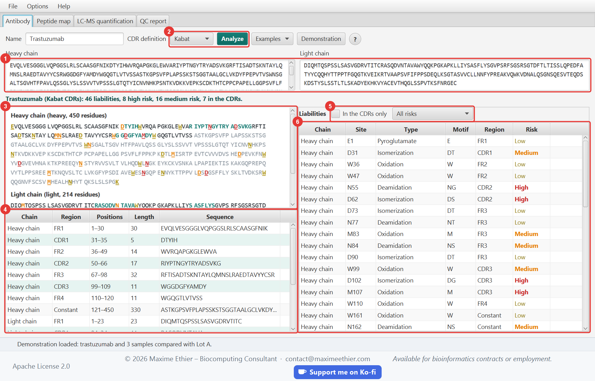
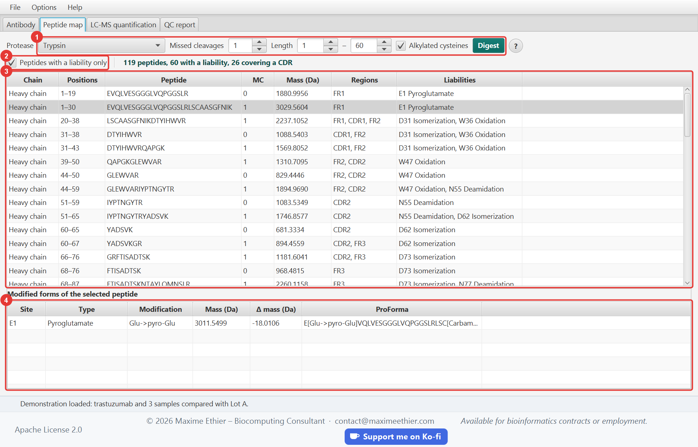
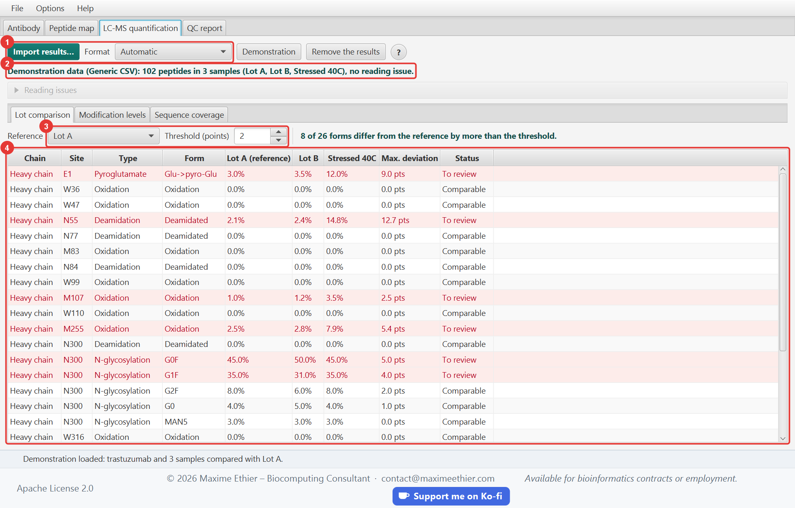
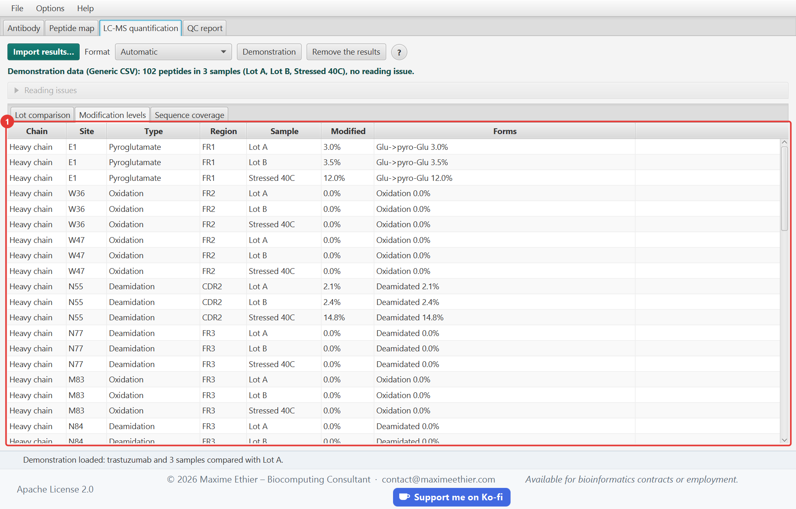
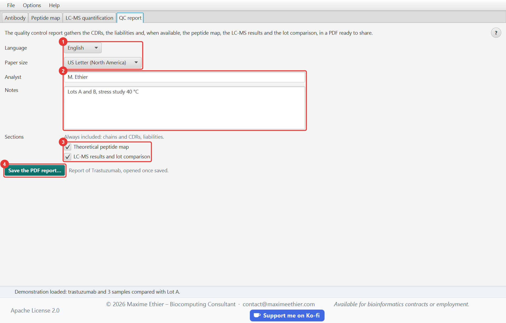

**MabScope user guide**

<!-- section: start -->
# Getting started

MabScope characterizes a therapeutic antibody from the sequence of its chains: it locates the CDRs, flags the liabilities (deamidation, oxidation, glycosylation…), computes the theoretical peptide map, quantifies the modifications measured by LC-MS and compares lots. Everything ends with a quality control report in PDF.

1. Paste the heavy and light chains in the **Antibody** tab (residues or FASTA), then click **Analyze**.
2. Review the peptide map in the **Peptide map** tab.
3. Import the results of MaxQuant, FragPipe or Skyline in the **LC-MS quantification** tab to measure the modification level of each site and compare the lots.
4. Save the PDF report in the **QC report** tab.

> To discover the application without your own data, press Ctrl+D: the demonstration loads trastuzumab and the simulated results of three samples (two lots and a sample stressed at 40 °C).

The **?** button of each tab, or the F1 key, opens this guide at the section of the current tab. The status bar, at the bottom of the window, summarizes the result of each operation and explains the errors.

<!-- section: antibody -->
# Antibody tab

## Entering the sequences

Paste each chain in its box: the residues alone, or a FASTA record. Spaces, digits and the FASTA header line are ignored. A single chain is enough, for instance for a nanobody or a fragment. The **Examples** menu fills in the sequences of trastuzumab or adalimumab.

The **CDR definition** sets their boundaries:

| Definition | Principle |
|---|---|
| Kabat | sequence variability; the most used in engineering |
| Chothia | structural loops; CDR-H1 starts later |
| AbM | compromise between Kabat and Chothia, used by Oxford Molecular’s AbM software |

The CDRs are located with the [rules of Andrew Martin](http://www.bioinf.org.uk/abs/info.html#cdrid) (conserved motifs such as the cysteine before CDR3 and the WGxG motif after it). When a sequence does not look like an antibody chain of its type, the status bar says so.

## Reading the results

- The **sequence view** shows the residues in blocks of ten: CDRs in teal, constant domains in grey. Liability sites are underlined in the color of their risk; hover them for details.
- The **region table** gives the positions and sequence of each region (FR1 to FR4, CDR1 to CDR3, constant domain). CDRs are highlighted.
- The **liability table** lists each site: chain, position, type, motif, region and risk level. Filter it by risk level or tick **In the CDRs only**.

## Liability rules

| Type | Motif | Risk |
|---|---|---|
| Deamidation | NG; NS; NT, NN, NH | high; medium; low |
| Isomerization | DG; DS; DT, DD, DH | high; medium; low |
| Asp-Pro cleavage | DP | medium |
| Oxidation | M; W | medium; low |
| N-glycosylation | N-X-S/T (X ≠ P) in the variable domain; in the constant domain (expected Fc glycan) | high; low |
| Unpaired cysteine | cysteine of the variable domain other than the two of its conserved disulfide bond | high |
| Pyroglutamate | N-terminal Q; E | medium; low |
| C-terminal lysine | C-terminal K of the heavy chain | low |

A site inside a CDR is raised by one risk level, since a modification there can change antigen binding.



<!-- section: peptide-map -->
# Peptide map tab

The theoretical peptide map lists the peptides expected after digestion of each chain, with their monoisotopic mass, the regions they cover and the liabilities they contain.

- **Protease**: trypsin by default; Lys-C, Arg-C, Glu-C, Asp-N and chymotrypsin are also available.
- **Missed cleavages**: largest number of internal sites left uncleaved in a peptide.
- **Length**: shortest and longest peptides kept.
- **Alkylated cysteines**: cysteines reduced and alkylated with iodoacetamide (+57.021 Da), as in most protocols.

Click **Digest** to apply the settings. Tick **Peptides with a liability only** to keep the peptides to monitor by LC-MS.

Select a peptide to see its **modified forms**: the mass of each form, its mass shift from the unmodified peptide and its sequence in ProForma notation, ready to paste in a search engine. A right-click copies the ProForma sequence.



<!-- section: quantification -->
# LC-MS quantification tab

Import the results of a mass spectrometry software with **Import results…** (Ctrl+O). The format is recognized from the columns; you can also impose it. The accepted formats are described in the “File formats” section.

For each liability site, MabScope adds up the intensity of the peptides covering it, modified or not, and computes the **modification level**:

> modification level = intensity of the modified forms ÷ total intensity of the peptides covering the site

## Lot comparison

Choose the **reference** sample, usually the reference standard, and the acceptable **threshold**, in percentage points (2 by default). The table shows, for each modified form, its level in each sample and the largest deviation from the reference. Rows above the threshold are highlighted and marked **To review**.



## Modification levels and coverage

The **Modification levels** tab details each site by sample, with the level of each form. The **Sequence coverage** tab gives the part of each chain covered by the observed peptides; observed sequences found in no chain are listed below.



Unreadable lines of the file are skipped and listed under **Reading issues**; the rest of the file is imported.

<!-- section: report -->
# QC report tab

The quality control report gathers, in a PDF ready to share:

- the identity of the antibody, its chains and CDRs;
- the liabilities;
- optionally, the theoretical peptide map;
- optionally, the LC-MS results and the lot comparison.

Choose the **language** of the report (English or French) and the **paper size**: US Letter in North America, A4 elsewhere. The **analyst** and the **notes** (batch numbers, method, conclusions) are printed in the header. Click **Save the PDF report…** (Ctrl+S): the report opens once saved.



<!-- section: formats -->
# File formats

| Software | File | Columns used |
|---|---|---|
| MaxQuant | `evidence.txt` | `Modified sequence`, `Experiment` or `Raw file`, `Intensity` |
| FragPipe | `psm.tsv` (IonQuant) | `Peptide`, `Assigned Modifications`, `Spectrum File`, `Intensity` |
| Skyline | exported report | `Peptide Modified Sequence`, `Replicate Name`, `Total Area MS1` or `Total Area` |
| Generic | CSV | `sequence` (ProForma), `sample`, `intensity` |

MaxQuant “Reverse” and “Potential contaminant” rows are skipped, as are rows without intensity. Modifications are recognized by their name in each software (`(Deamidation (NQ))`, `(Oxidation (M))`, `[Deamidated]`…) or by their mass shift (`N[+0.984]`): deamidation, oxidation, pyroglutamate, carbamidomethylation, acetylation and phosphorylation. The loss of the C-terminal lysine is measured with the C-terminal peptide, with or without its lysine.

The `sequence` column of the generic table follows the [ProForma 2.0 notation](https://www.psidev.info/proforma) of HUPO-PSI. Example:

```text
sequence,sample,intensity
IYPTN[Deamidated]GYTR,Lot A,50400
IYPTNGYTR,Lot A,2349600
```

<!-- section: options -->
# Options and shortcuts

The **Options** menu changes the language of the interface (English or French) and the text size. These choices are kept from one session to the next.

| Shortcut | Action |
|---|---|
| Ctrl+N | New analysis |
| Ctrl+D | Load the demonstration |
| Ctrl+O | Import LC-MS results |
| Ctrl+S | Save the QC report |
| Ctrl+1 to Ctrl+4 | Show tab 1 to 4 |
| Ctrl+= / Ctrl+- / Ctrl+0 | Larger, smaller or default text |
| F1 | Help on the current tab |

<!-- section: troubleshooting -->
# Troubleshooting

- **“A sequence is not an antibody chain of its type”**: check that the heavy and light chains are not swapped and that the sequence contains the whole variable domain.
- **No site quantified**: analyze the antibody first, then check that the peptides of the file come from the same sequence (see the unmatched sequences below the coverage).
- **Format not recognized**: impose the format in the list, or convert the file to a generic table.
- **Reading issues**: open the list in the quantification tab; each issue gives the line and the cause.

> MabScope is for research only. Its results must be confirmed by validated analytical methods.
