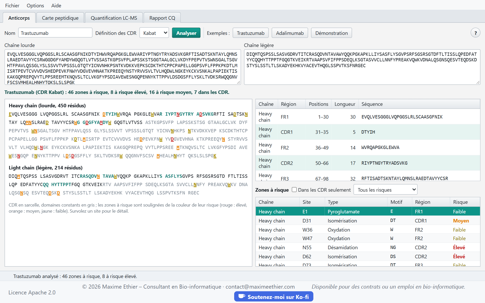
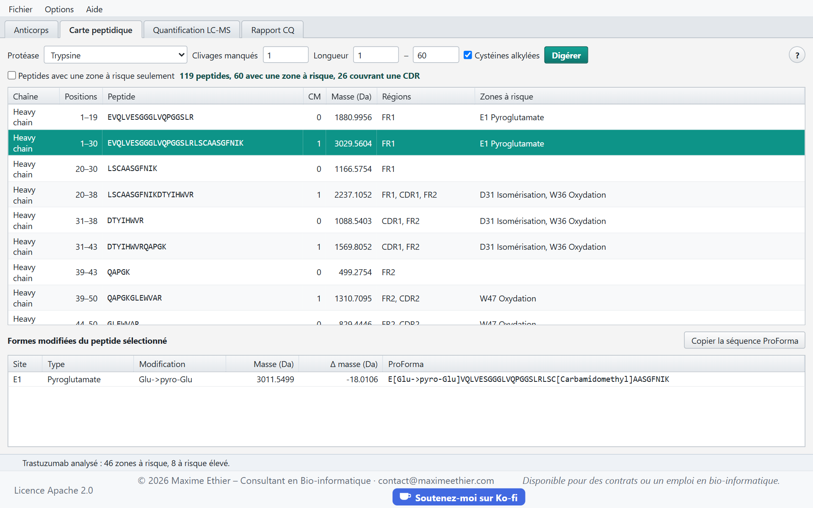
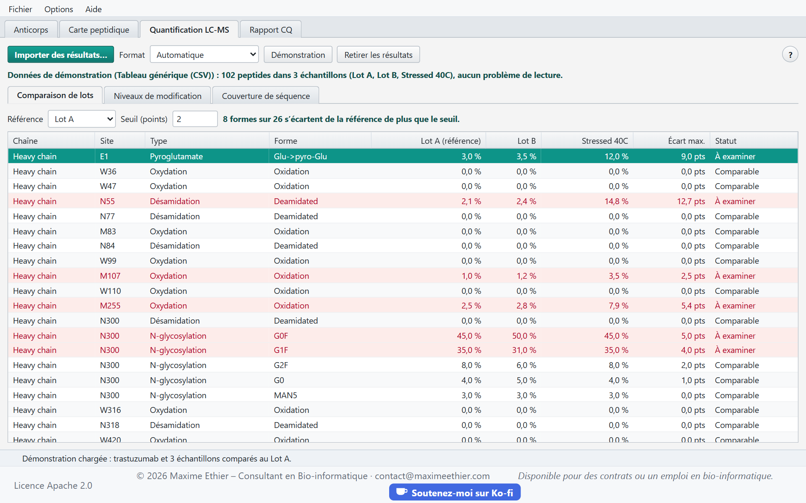
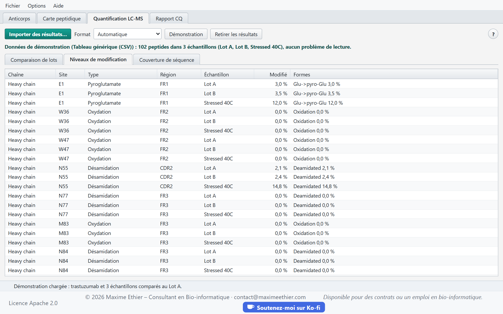
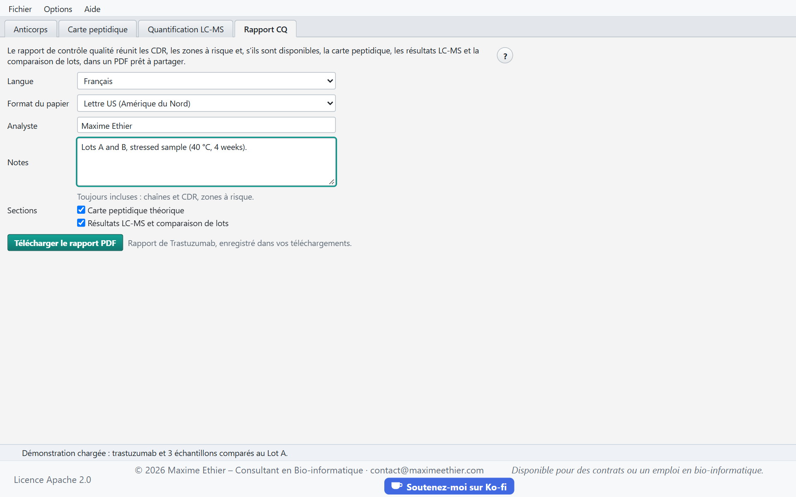

**Guide d’utilisation de MabScope**

<!-- section: start -->
# Démarrage rapide

MabScope caractérise un anticorps thérapeutique à partir de la séquence de ses chaînes : il repère les CDR, signale les zones à risque (désamidation, oxydation, glycosylation…), calcule la carte peptidique théorique, quantifie les modifications mesurées par LC-MS et compare des lots entre eux. Tout se termine par un rapport de contrôle qualité en PDF.

1. Collez la chaîne lourde et la chaîne légère dans l’onglet **Anticorps** (résidus seuls ou FASTA), puis cliquez sur **Analyser**.
2. Consultez la carte peptidique dans l’onglet **Carte peptidique**.
3. Importez les résultats de MaxQuant, FragPipe ou Skyline dans l’onglet **Quantification LC-MS** pour mesurer le taux de modification de chaque site et comparer les lots.
4. Téléchargez le rapport PDF dans l’onglet **Rapport CQ**.

> Pour découvrir l’application sans vos données, appuyez sur Ctrl+D ou cliquez sur **Démonstration** : la démonstration charge le trastuzumab et les résultats simulés de trois échantillons (deux lots et un échantillon stressé à 40 °C).

Le bouton **?** de chaque onglet, ou la touche F1, ouvre ce guide à la section de l’onglet courant. La barre d’état, en bas de la page, résume le résultat de chaque opération et explique les erreurs.

Les calculs sont faits par le serveur de MabScope ; vos séquences et vos fichiers ne sont pas conservés après chaque calcul. L’application de bureau offre les mêmes fonctions sans connexion.

<!-- section: antibody -->
# Onglet Anticorps

## Saisir les séquences

Collez chaque chaîne dans sa zone : les résidus seuls, ou un enregistrement FASTA. Les espaces, les chiffres et la ligne d’en-tête FASTA sont ignorés. Une seule chaîne suffit, par exemple pour un nanocorps ou un fragment. Les boutons **Trastuzumab** et **Adalimumab** remplissent les séquences d’un anticorps d’exemple et l’analysent.

La **définition des CDR** fixe leurs bornes :

| Définition | Principe |
|---|---|
| Kabat | variabilité des séquences ; la plus utilisée en ingénierie |
| Chothia | boucles structurales ; CDR-H1 plus court au début |
| AbM | compromis entre Kabat et Chothia, utilisé par le logiciel AbM d’Oxford Molecular |

Les CDR sont repérés avec les [règles d’Andrew Martin](http://www.bioinf.org.uk/abs/info.html#cdrid) (motifs conservés comme la cystéine avant le CDR3 et le motif WGxG après). Si une séquence ne ressemble pas à une chaîne d’anticorps de son type, la barre d’état l’indique.

## Lire les résultats

- La **vue des séquences** affiche les résidus par blocs de dix : les CDR en sarcelle, les domaines constants en gris. Les sites à risque sont soulignés dans la couleur de leur risque ; survolez-les pour le détail.
- Le **tableau des régions** donne les positions et la séquence de chaque région (FR1 à FR4, CDR1 à CDR3, domaine constant). Les CDR sont surlignés.
- Le **tableau des zones à risque** liste chaque site : chaîne, position, type, motif, région et niveau de risque. Filtrez-le par niveau de risque ou cochez **Dans les CDR seulement**.

## Règles des zones à risque

| Type | Motif | Risque |
|---|---|---|
| Désamidation | NG ; NS ; NT, NN, NH | élevé ; moyen ; faible |
| Isomérisation | DG ; DS ; DT, DD, DH | élevé ; moyen ; faible |
| Coupure Asp-Pro | DP | moyen |
| Oxydation | M ; W | moyen ; faible |
| N-glycosylation | N-X-S/T (X ≠ P) dans le domaine variable ; dans le domaine constant (glycane Fc attendu) | élevé ; faible |
| Cystéine non appariée | cystéine du domaine variable autre que les deux de son pont disulfure conservé | élevé |
| Pyroglutamate | Q ; E en position N-terminale | moyen ; faible |
| Lysine C-terminale | K C-terminal de la chaîne lourde | faible |

Un site situé dans un CDR monte d’un niveau de risque, car une modification à cet endroit peut modifier la liaison à l’antigène.



<!-- section: peptide-map -->
# Onglet Carte peptidique

La carte peptidique théorique liste les peptides attendus après digestion de chaque chaîne, avec leur masse monoisotopique, les régions couvertes et les zones à risque qu’ils contiennent.

- **Protéase** : trypsine par défaut ; Lys-C, Arg-C, Glu-C, Asp-N et chymotrypsine sont aussi disponibles.
- **Clivages manqués** : nombre maximal de sites internes non coupés dans un peptide.
- **Longueur** : peptides les plus courts et les plus longs conservés.
- **Cystéines alkylées** : cystéines réduites et alkylées à l’iodoacétamide (+57,021 Da), comme dans la plupart des protocoles.

Cliquez sur **Digérer** pour appliquer les paramètres. Cochez **Peptides avec une zone à risque seulement** pour ne garder que les peptides à surveiller en LC-MS.

Sélectionnez un peptide pour voir ses **formes modifiées** : la masse de chaque forme, l’écart de masse avec le peptide non modifié et sa séquence en notation ProForma, prête à coller dans un logiciel de recherche. Un double-clic sur une ligne, ou le bouton **Copier la séquence ProForma**, copie la séquence.



<!-- section: quantification -->
# Onglet Quantification LC-MS

Importez les résultats d’un logiciel de spectrométrie de masse avec **Importer des résultats…** (Ctrl+O). Le format est reconnu d’après les colonnes ; vous pouvez aussi l’imposer. Les formats acceptés sont décrits à la section « Formats des fichiers ».

Pour chaque site à risque, MabScope additionne l’intensité des peptides qui le couvrent, modifiés ou non, et calcule le **taux de modification** :

> taux de modification = intensité des formes modifiées ÷ intensité totale des peptides couvrant le site

## Comparaison des lots

Choisissez l’échantillon de **référence**, en général le standard de référence, et le **seuil** acceptable, en points de pourcentage (2 par défaut). Le tableau affiche, pour chaque forme modifiée, son taux dans chaque échantillon et l’écart maximal avec la référence. Les lignes qui dépassent le seuil sont surlignées et marquées **À examiner**.



## Niveaux de modification et couverture

L’onglet **Niveaux de modification** détaille chaque site par échantillon, avec le taux de chaque forme. L’onglet **Couverture de séquence** indique la part de chaque chaîne couverte par les peptides observés ; les séquences observées qui ne correspondent à aucune chaîne sont listées en dessous.



Les lignes illisibles du fichier sont ignorées et listées dans **Problèmes de lecture** ; le reste du fichier est importé.

<!-- section: report -->
# Onglet Rapport CQ

Le rapport de contrôle qualité réunit, dans un PDF prêt à partager :

- l’identité de l’anticorps, ses chaînes et ses CDR ;
- les zones à risque ;
- en option, la carte peptidique théorique ;
- en option, les résultats LC-MS et la comparaison des lots.

Choisissez la **langue** du rapport (français ou anglais) et le **format du papier** : Lettre US en Amérique du Nord, A4 ailleurs. L’**analyste** et les **notes** (numéros de lot, méthode, conclusions) sont imprimés dans l’en-tête. Cliquez sur **Télécharger le rapport PDF** (Ctrl+S) : le navigateur l’enregistre dans vos téléchargements.



<!-- section: formats -->
# Formats des fichiers

| Logiciel | Fichier | Colonnes utilisées |
|---|---|---|
| MaxQuant | `evidence.txt` | `Modified sequence`, `Experiment` ou `Raw file`, `Intensity` |
| FragPipe | `psm.tsv` (IonQuant) | `Peptide`, `Assigned Modifications`, `Spectrum File`, `Intensity` |
| Skyline | rapport exporté | `Peptide Modified Sequence`, `Replicate Name`, `Total Area MS1` ou `Total Area` |
| Générique | CSV | `sequence` (ProForma), `sample`, `intensity` |

Les lignes « Reverse » et « Potential contaminant » de MaxQuant sont ignorées, de même que les lignes sans intensité. Les modifications sont reconnues sous leur nom dans chaque logiciel (`(Deamidation (NQ))`, `(Oxidation (M))`, `[Deamidated]`…) ou par leur écart de masse (`N[+0.984]`) : désamidation, oxydation, pyroglutamate, carbamidométhylation, acétylation et phosphorylation. La perte de la lysine C-terminale se mesure avec le peptide C-terminal, avec ou sans sa lysine.

La colonne `sequence` du tableau générique suit la [notation ProForma 2.0](https://www.psidev.info/proforma) du HUPO-PSI. Exemple :

```text
sequence,sample,intensity
IYPTN[Deamidated]GYTR,Lot A,50400
IYPTNGYTR,Lot A,2349600
```

Les fichiers peuvent atteindre 100 Mo.

<!-- section: options -->
# Options et raccourcis

Le menu **Options** change la langue de l’interface (français ou anglais) et la taille du texte. Ces choix sont conservés par votre navigateur d’une visite à l’autre.

| Raccourci | Action |
|---|---|
| Ctrl+D | Charger la démonstration |
| Ctrl+O | Importer des résultats LC-MS |
| Ctrl+S | Télécharger le rapport CQ |
| Alt+1 à Alt+4 | Afficher l’onglet 1 à 4 |
| Ctrl+= / Ctrl+- / Ctrl+0 | Agrandir, réduire ou rétablir le texte |
| F1 | Aide de l’onglet courant |
| Ctrl+F | Rechercher dans le guide, une fois ouvert |
| Échap | Effacer la recherche, puis fermer le guide |

Sur un Mac, utilisez ⌘ au lieu de Ctrl et ⌥ au lieu de Alt.

<!-- section: troubleshooting -->
# Dépannage

- **« Une séquence n’est pas une chaîne d’anticorps de son type »** : vérifiez que la chaîne lourde et la chaîne légère ne sont pas inversées et que la séquence contient le domaine variable complet.
- **Aucun site quantifié** : analysez d’abord l’anticorps, puis vérifiez que les peptides du fichier proviennent de la même séquence (voir les séquences non retrouvées sous la couverture).
- **Format non reconnu** : imposez le format dans la liste, ou convertissez le fichier en tableau générique.
- **Problèmes de lecture** : ouvrez la liste dans l’onglet de quantification ; chaque problème indique la ligne et la cause.
- **« Le serveur ne répond pas »** : vérifiez votre connexion, puis réessayez dans un instant.

> MabScope est destiné à la recherche. Ses résultats doivent être confirmés par des méthodes analytiques validées.
